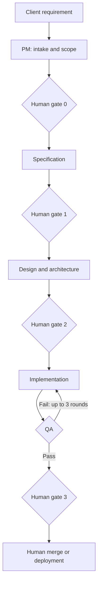

# Agent Factory | תהליך וחלוקת אחריות

## מטרת התכנון

סוכן מנהל אחד מרכז את התהליך ומנתב עבודה לפי תוצרים וסטטוסים. בעלי תפקידים נפרדים מגדירים דרישות, מתכננים, בונים ובודקים. ארבע החלטות מרכזיות נשארות בידי אדם.

התרשים מתאר את תהליך היעד; לא אומתה עדיין הרצה מלאה שלו.

## סוכני הליבה שנצפו במאגר המקור

| סוכן | אחריות לפי התכנון | גבול אחריות |
|---|---|---|
| pm | ניתוב, מצב, סיכונים, שערים והסלמות | אינו מאשר שערים או קובע PASS במקום QA |
| spec | דרישות וקריטריוני קבלה | שינוי בדרישות שאושרו מחייב פתיחה מחדש |
| design | תכנון מסכים ועיצוב | אינו בעל סמכות לפריסה |
| builder | בניית תוצרים בהיקף שאושר | כפוף לדרישות ולתחום הכתיבה |
| qa | בדיקה מול קריטריונים ודיווח ראיות | אינו מחליף את החלטת האדם |

מתוכננים גם תפקידי התמחות ותמיכה, כגון ארכיטקטורה, סקירת אבטחה, תכנון AI, תיעוד, מחקר והכנת שחרור. קיומם ותפקודם אינם מאומתים במאגר ציבורי זה.

## חוזי העבודה

הגדרת pm שנכללת במאגר מתארת:

- Brief לפני כל קריאה לסוכן, עם מטרה, קלט, מגבלות ותקציב.
- סטטוס סיום מוגדר: `DONE`, `BLOCKED` או `NEEDS_HUMAN`.
- בדיקת אישורי שערים לפני ניתוב.
- הגבלת מחזורי בנייה ו-QA לשלושה.
- הסלמה במקרה של מידע חסר, סתירה או חריגה.
- דרישה להבחין בין קובץ שנכתב בפועל לבין דיווח על כוונה.

זהו חוזה התנהגותי. בדיקת אכיפה דורשת גם runtime, הרשאות, hooks ותרחישי עקיפה.

## שכבת בקרה

| שכבה | תפקיד | מצב הראיות |
|---|---|---|
| כללי תפקיד | מי רשאי לבצע איזו משימה | דוגמת pm נבדקה כטקסט |
| תצורת כלים והרשאות | הגבלת כלים ופעולות | קיימת במקור; לא נכללת כאן ולא נבדקה מחדש |
| אישור שערים ונעילה | מניעת התקדמות ושינוי תוצרים מאושרים | מתואר ביומן ההתקדמות; מחוץ לבדיקות הנוכחיות |
| מתג עצירה | יצירת `state/STOP` ותגובה של hook | רכיב נבחר עם 18 בדיקות שעברו בסביבה זמנית |
| מדידה ושחזור | עלות, זמן, יומנים ו-checkpoints | מתוכננים או לא מאומתים כאן |

## החלטות הנדסיות שדורשות המשך אימות

- הנחיה בפרומפט אינה תחליף לבקרת הרשאה טכנית.
- ה-hook המצורף אינו מספק sandbox; רישום ושרשרת ההפעלה אינם נכללים.
- קובץ עצירה יעיל רק כאשר כלי העבודה אכן מפעילים את ה-hook ואין מסלול עקיפה.
- יומן hash יכול לסייע בזיהוי שינוי, אך לבדו אינו מונע שינוי.
- יש לבדוק מחדש התנהגות לאחר שינוי גרסת כלי העבודה.
- הפרדת סביבות עבודה, הגנת מעטפת הפקודות וניתוב בין סוכנים עדיין דורשים בדיקות.

